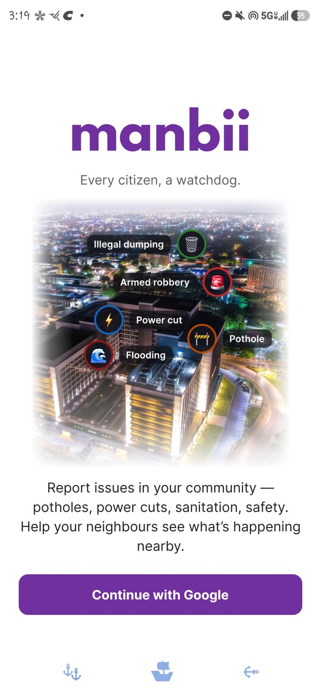
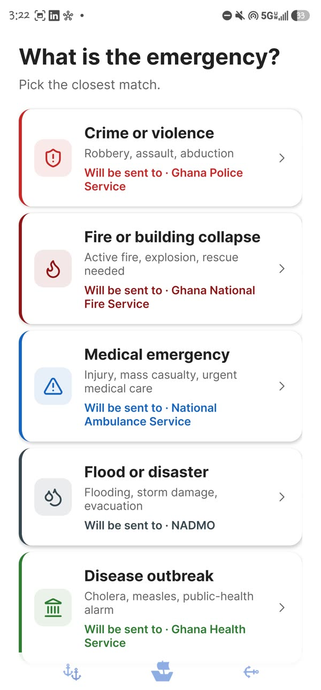
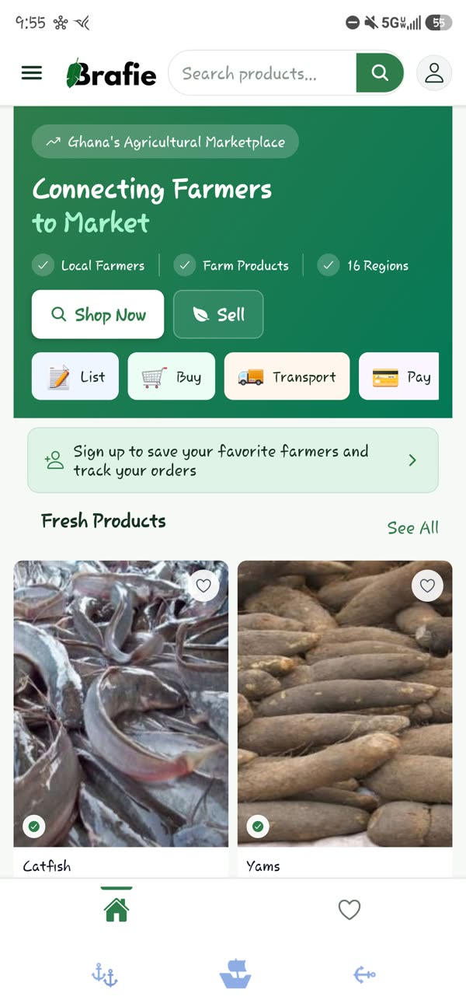
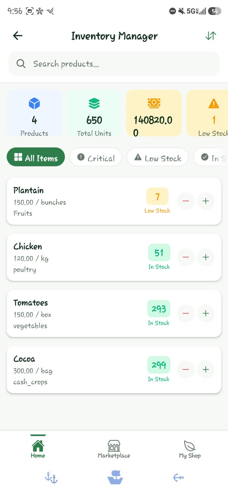
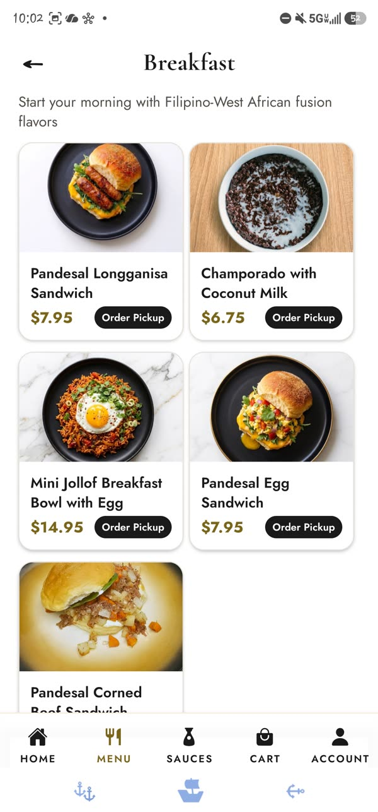
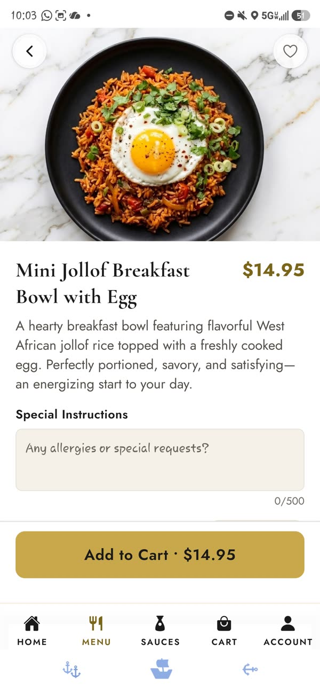

# Hi, I'm Felix Agyei 👋

**Data Engineering & Analytics professional with 10+ years of experience** designing ETL/ELT pipelines, data warehouses and business intelligence systems that turn complex data into decisions. I work mostly in **Python, SQL, Azure Data Factory, SSIS and Power BI**.

I also build AI-powered and full-stack applications: data platforms, marketplaces and mobile apps, **two of them live on the App Store and Google Play**.

📍 Canyon Country, CA · 💼 [LinkedIn](https://www.linkedin.com/in/felix-agyei-dit-8210b078) · ✉️ [felix.agyeio4@gmail.com](mailto:felix.agyeio4@gmail.com)

🎯 **Open to:** Data Engineering · Analytics Engineering · AI-enabled data platforms · Automation · Modern data architecture

---

## What I do

- **Data engineering:** ETL/ELT pipelines with Azure Data Factory, SSIS and Python; troubleshooting failed pipelines and tuning slow ones
- **Data modeling & warehousing:** dimensional models, data warehouses, and the SQL behind them
- **Business intelligence:** Power BI dashboards and reporting systems that people use to make decisions
- **Data quality & governance:** validation, lineage and reconciliation, so the numbers can be trusted
- **AI & automation:** LLMs, the OpenAI API, AI agents, and workflow automation with n8n and Power Automate
- **Software engineering:** REST APIs and full-stack web and mobile applications in production

---

## Projects

> Most of my code lives in private repositories. **I'm happy to give read access to any project below on request.**

### 🏫 Attendance Auditor: data-quality audit pipeline for school attendance
Extracts historical attendance records from PowerSchool, runs them through a rules engine that flags likely errors with explainable confidence scores, and gives reviewers an evidence-first workflow to approve fixes and export them.

**Stack:** TypeScript · PostgreSQL · Redis / BullMQ · Next.js · Docker · OIDC

**Highlights:**
- **Extraction:** PowerSchool OAuth extraction with retries, run in time windows by a resumable background worker
- **Data quality:** 12 canonical audit rules (AT-001 to AT-012) with transparent confidence scoring
- **Lineage & integrity:** immutable source snapshots with completeness checks and manifest hashes; every finding links back to its evidence; review history is append-only
- **Reconciliation:** after a fix, the system re-reads the source records and marks each finding verified, unresolved or changed at source
- **Governed output:** checksummed CSV exports of approved findings, school-scoped access control, and fail-closed defaults

---

### 🍲 GhCater: catering marketplace for Ghana
Connects customers with caterers for everything from corporate meal programs to weddings, funerals and birthday parties. Customers order from a menu or request quotes from up to five caterers, pay online, and track their order to delivery.

**Stack:** TypeScript · Fastify · PostgreSQL · Next.js 16 · Paystack · pnpm/Turborepo

**Highlights:**
- **Financial data done properly:** a double-entry ledger, escrow until the order completes, weekly caterer payouts net of commission, and daily reconciliation against Paystack
- **Corporate accounts:** cost centers, PO numbers, approval limits and recurring weekly meal programs
- **Operations analytics:** marketplace metrics for staff, error reporting, scheduled checks of the books, and a runbook for every alert
- **Full marketplace flow:** search ranked by caterer performance, ordering, quotes, deposits, cancellations and refunds
- Designed through 28 architecture decision records, with an OpenAPI contract that tests keep in sync with the code

*Phase 1 in active development.*

---

### 🛡️ Manbii: civic reporting app for Ghana
Citizens report broken infrastructure, safety, sanitation and utility issues on a live neighbourhood map, and get push alerts for problems near home or in areas they watch. Emergencies are routed to the right government agency.

**Stack:** Expo / React Native · PostgreSQL + PostGIS · Supabase (Auth, Storage, Edge Functions) · MapLibre · Sentry

**Highlights:**
- **Geospatial data:** PostGIS queries for nearby reports and watch zones, with map clustering for dense areas
- **Data security:** row-level security with automated tests, a written threat model, and secret scanning in CI
- **Database discipline:** forward-only migrations with automated schema-drift checks before each release
- **Offline-first:** reports queue on the device and sync when the connection returns

  
  
  
  

🔗 [Demo video](https://www.youtube.com/shorts/c240ZK2imUg)

---

### 🌱 Brafie: agricultural marketplace *(formerly AgriLink GH)*
Connects Ghanaian farmers, buyers and transporters for direct trade and logistics.

**Stack:** React / React Native · Node.js / Express · MongoDB · Firebase Auth · Cloudinary

**Highlights:**
- Farmer dashboard with listings, views, ratings and a live weather forecast
- Inventory management with stock levels, low-stock alerts and total stock value
- Three user roles (farmer, buyer, transporter); escrow payments with Mobile Money
- Real-time messaging, notifications, market prices and dispute resolution

  
  
  
  

📱 **Live on** [App Store](https://apps.apple.com/us/app/brafie/id6759975438) · [Google Play](https://play.google.com/store/apps/details?id=com.brafie.app) · 🔗 [brafie.com](https://www.brafie.com/)

---

### 🍽️ Masarap Cafe: restaurant ordering platform
Online ordering for a Filipino–West African fusion restaurant, with a customer web app, a mobile app and a shared API.

**Stack:** Next.js 15 · Expo / React Native · Node.js / Express · MongoDB · Stripe · Docker

**Highlights:**
- Monorepo with the web app, mobile app and API sharing one package of types
- Stripe checkout and order flow
- Documented secret-rotation process with a CI audit workflow

  
  
  
  

📱 **Live on** [App Store](https://apps.apple.com/us/app/masarap-cafe/id6786804576) · [Google Play](https://play.google.com/store/apps/details?id=com.masarapcafe.app) · 🔗 [masarapcafe.com](https://masarapcafe.com/)

---

### 🎉 Yedede: social platform for celebrating "firsts"
A video-first social app where people share and celebrate first-time experiences.

**Stack:** Next.js 14 · Expo / React Native · PostgreSQL + Prisma · Cloudflare Stream & R2 · Upstash Redis · PostHog

**Highlights:**
- Video upload, transcoding and HLS playback via Cloudflare Stream
- AI-generated background music (MusicGen via Replicate)
- Background job worker, Redis-backed rate limiting, and product analytics with PostHog

---

## Tech I use

**Data:** Python · SQL · Azure Data Factory · SSIS · Power BI · Data warehousing · Dimensional modeling · PostgreSQL · PostGIS · MongoDB · Redis  
**AI & automation:** OpenAI API · LLMs · AI agents · n8n · Power Automate  
**Software:** TypeScript · Node.js · Fastify · Next.js · React Native / Expo · REST APIs  
**Cloud & ops:** Azure · Docker · Vercel · Render · Cloudflare · GitHub Actions · Sentry
