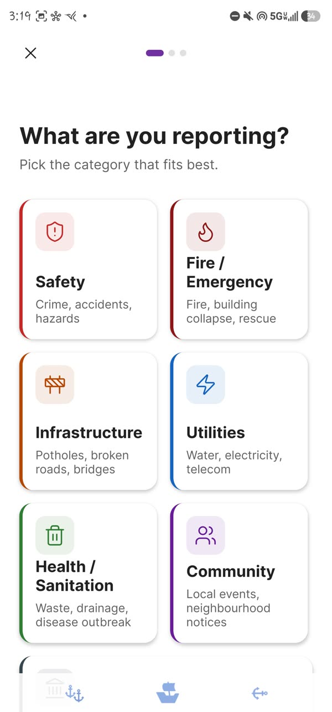
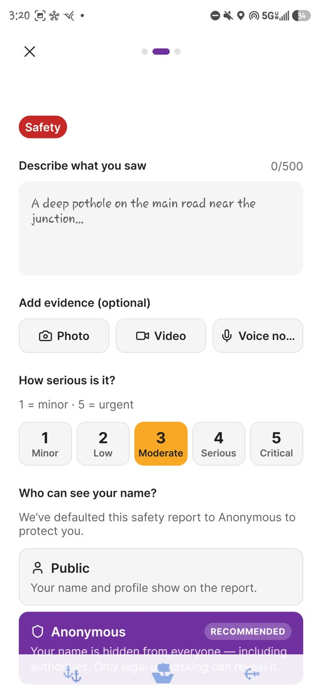
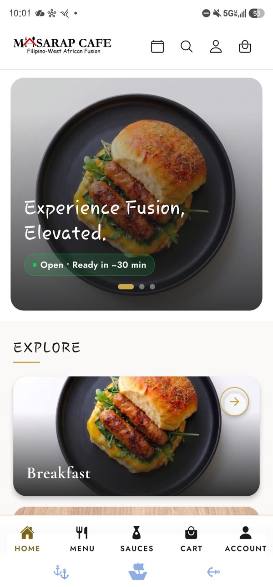
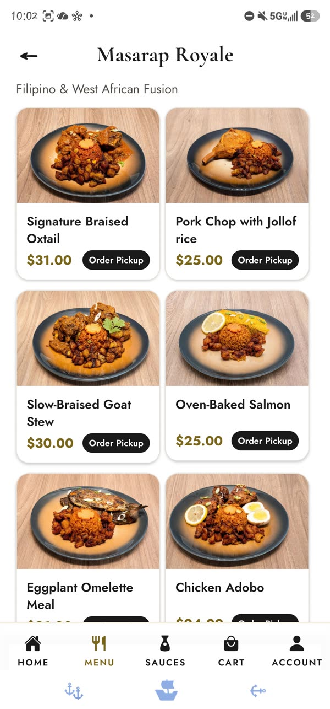
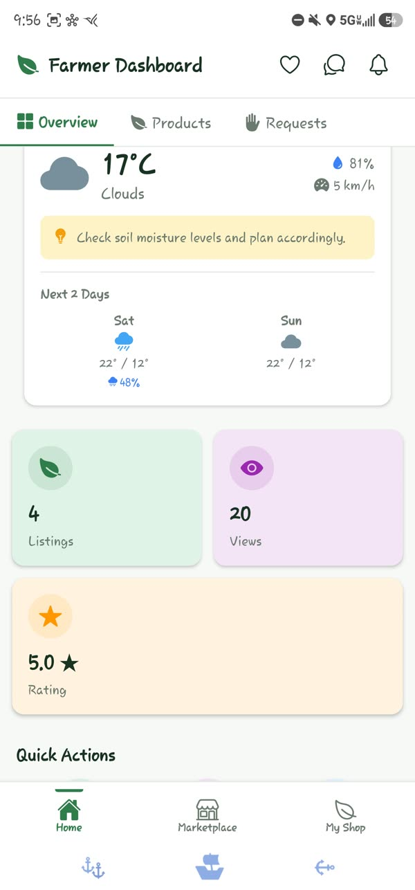
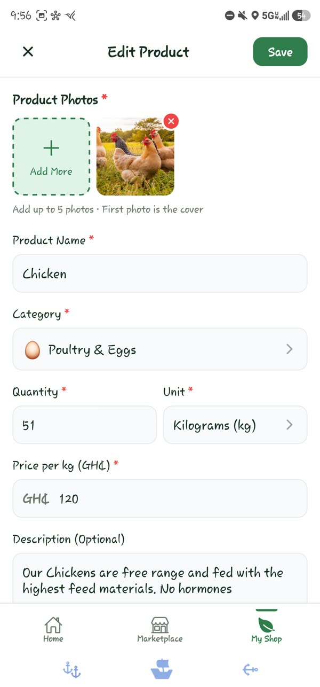

# Hi, I'm Felix Agyei 👋

Full-stack developer building production mobile and web apps with **React Native (Expo)**, **Next.js**, **Node.js**, **PostgreSQL / Supabase** and **MongoDB**. I like shipping real products end to end: data model, API, mobile app, release pipeline and monitoring.

📍 Canyon Country, CA · 💼 [LinkedIn](https://www.linkedin.com/in/felix-agyei-dit-8210b078) · ✉️ [felix.agyeio4@gmail.com](mailto:felix.agyeio4@gmail.com)

> Most of my code lives in private repositories. **I'm happy to give read access to any project below on request.**

---

## Projects

### 🛡️ Manbii: civic reporting app for Ghana
Citizens report broken infrastructure, safety, sanitation and utility issues on a live neighbourhood map, and get push alerts for problems near home or in areas they watch.

**Stack:** Expo / React Native · Supabase (Postgres + PostGIS, Auth, Storage, Edge Functions) · MapLibre · Sentry
**Highlights:**
- Geospatial queries with PostGIS and map clustering for dense report areas
- Offline-first reporting: reports queue on the device and sync when the connection returns
- Security-first backend: row-level security with automated RLS tests, a written threat model, and secret scanning of the app bundle in CI
- Release tooling: schema-drift checks, bundle-size budgets and production-readiness checks before each release

  
  
  
  

🔗 [Demo video](https://www.youtube.com/shorts/c240ZK2imUg)

---

### 🍲 GhCater: catering marketplace for Ghana
Connects customers with caterers for everything from corporate meal programs to weddings, funerals and birthday parties. Customers order from a menu or request quotes from up to five caterers, pay online, and track their order to delivery.

**Stack:** TypeScript · Fastify · Next.js 16 · PostgreSQL · Paystack · pnpm/Turborepo
**Highlights:**
- Full marketplace flow: search, ordering, quote requests, deposits and balances, cancellations and refunds
- Money handled properly: Paystack payments and webhooks, a double-entry ledger, escrow until the order completes, weekly caterer payouts net of commission, and daily reconciliation against Paystack
- Corporate accounts with cost centers, PO numbers, approval limits and recurring weekly meal programs
- Caterer portal, an admin console behind roles and two-factor auth, caterer document verification, and malware scanning of every upload
- Designed through 28 architecture decision records, with an OpenAPI contract that tests keep in sync with the code

*Phase 1 in active development.*

---

### 🎉 Yedede: social platform for celebrating "firsts"
A video-first social app where people share and celebrate first-time experiences.

**Stack:** Next.js 14 · Expo / React Native · Supabase + Prisma · Cloudflare Stream & R2 · Upstash Redis · Node worker · PostHog · Sentry
**Highlights:**
- Turborepo monorepo sharing types and validation across web, mobile and a background worker
- Video upload, transcoding and HLS playback via Cloudflare Stream
- AI-generated background music (MusicGen via Replicate)
- Redis-backed rate limiting; background jobs run on a separate worker service

---

### 🍽️ Masarap Cafe: restaurant ordering platform
Online ordering for a Filipino–West African fusion restaurant, with a customer web app, a mobile app and a shared API.

**Stack:** Next.js 15 · Expo / React Native · Node.js / Express · MongoDB (Mongoose) · Stripe · Docker
**Highlights:**
- pnpm/Turborepo monorepo with the web app, mobile app and API sharing one package of types
- Stripe checkout and order flow
- Documented secret-rotation process with a CI audit workflow

  
  
  
  

🔗 [masarapcafe.com](https://masarapcafe.com/)

---

### 🌱 Brafie: agricultural marketplace *(formerly AgriLink GH)*
Connects Ghanaian farmers, buyers and transporters for direct trade and logistics.

**Stack:** React · Node.js / Express · MongoDB · Firebase Auth · Cloudinary
**Highlights:**
- Three user roles (farmer, buyer, transporter), each with its own dashboard
- Escrow payments with Mobile Money integration
- Real-time messaging, notifications, market prices and dispute resolution

  
  
  
  

🔗 [brafie.com](https://www.brafie.com/)

---

### 🏫 Attendance Auditor: school attendance audit tool
Audits historical attendance records from PowerSchool, flags likely errors with transparent confidence scores, and supports human review and controlled export.

**Stack:** Next.js · TypeScript · Docker · Auth0
**Highlights:**
- Rule-based detection engine (12 rules) with explainable confidence scores
- Read-only and fail-closed by design: audit runs are immutable and every finding links to its evidence
- Reconciliation pass re-reads source records to confirm each fix landed

---

## Tech I use
**Mobile:** React Native, Expo, EAS · **Web:** Next.js, React, Tailwind · **Backend:** Node.js, Express, Supabase Edge Functions · **Data:** PostgreSQL, PostGIS, Prisma, MongoDB, Redis · **Infra:** Vercel, Render, Docker, Cloudflare · **Quality:** Jest, TypeScript, ESLint, Sentry, GitHub Actions
